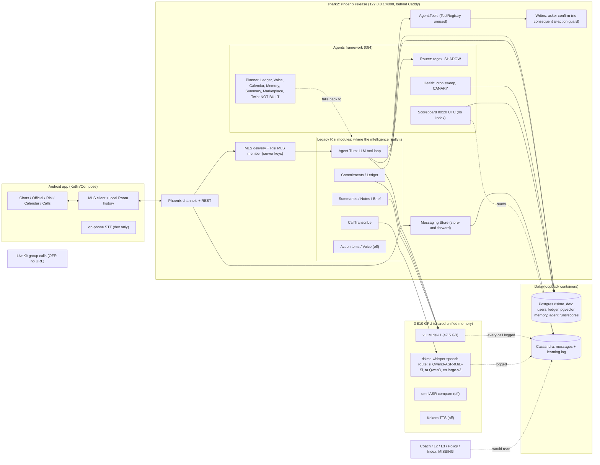

# Audit 2026-10-14: agents, learning, features, gaps (root, report only)

Harsha asked for this blunt. **Method:**
- I read the code (`server/lib/risime/agent/**`), decisions 084/085/090, the release docs, `switched-off.md`,
  `NEXT-PHASE.md` and the status docs.
- I ran **SELECT-only** queries on Postgres `risime_dev`. The pilot still runs on this database (a
  separate prod DB is not started), so these are the pilot's rows.
- I read the live `/api/v1/auth/config` of `v0.3.0-nightly.6`.
- Nothing was written, compiled or restarted. No names, phones or emails appear here.

## The blunt version (10 lines)
1. **We have 10 "agents" and 0 that reason.** Two have code (Router, Health); both are deterministic (regex
   rules; an SQL sweep on a 5-minute cron). The other 8 are spec stubs whose `run/2` returns
   `{:error, :not_built}` (`agents/planned.ex:27`).
2. **The real intelligence is still in legacy modules** (the `Agent.Turn` LLM tool loop, Commitments extraction,
   summaries, call transcription, action items). It lives outside the agent framework, its flags, and the
   promotion rule.
3. **The Intelligence Index does not exist in code.** There is no 0.7·Eval + 0.3·Live, no Index column, and
   no rollback on a drop. `Scoreboard.put_eval/3` has **no caller** outside tests, so golden-set results
   never reach `risi_agent_scores`.
4. **Nothing learns.** L1 is retrieval, not preference learning. L2 (prompt/few-shot optimisation) is not
   built. L3 (LoRA) is not built. The Coach agent is not built. `learned_version` is a constant string
   everywhere.
5. **The golden sets are tiny and not human-checked:** 81 cases in total (router 63, ledger 12, summary 6).
   The router's 63/63 is not held out (rules and set were written together). Decision 085 forbids exactly this:
   "No model ever grades itself without a human-checked golden set."
6. **The first measured scores are poor where they matter:**
   - ledger golden 6/12 (50%) with 2 hallucinations;
   - Sinhala and Tamil promise detection 1/4;
   - summaries 4/6 with 2 hallucinations;
   - Sinhala ASR 33% WER on spontaneous speech.
7. **No guard for consequential actions** (money, pay, HR, deletion, legal) exists. The rule is enforced only
   by the fact that no such tool exists yet.
8. **Policy as language is 0% built:** no Policy agent. Meeting, Image and Coach are missing too. Voice is a stub.
9. **Features are strong; intelligence is thin.** Messaging, MLS, calls, Ledger, Notes, Calendar and 1:1 call
   transcription are on. Group calls, Call Risi, voice-note transcription, action items, the admin console
   and GCal are built but off.
10. **Docs drift:** `SPEC-GAP.md` (nightly.47) and `risi-scores.md` ("no pilot rows yet") are stale. The
    nightly.7 user notes call on-phone voice-note transcripts "New", but they are dev-only (`phone_stt`).

## 1. Every agent
Registry: `server/lib/risime/agent/agents.ex:8-19`. Behaviour: `RisiMe.Agents.Agent` (`agents/agent.ex`).

**Flag resolution** (`flags.ex`):
- Order: the `risi_agent_flags` row, then the OS env, then `@defaults`.
- Defaults: `RISI_AGENTS=on`, `RISI_AGENT_ROUTER=shadow`, `RISI_AGENT_HEALTH=canary`; everything else is off.
- Canary means on for dev users and shadow for everyone else.
- **The `risi_agent_flags` table is empty**, so the defaults are live.

| Agent | Type | Goal (spec) | Tools | State | What it learns | Eval score | Really an agent? |
|---|---|---|---|---|---|---|---|
| **Router** | specialist | right path for each ask: rules < 50 ms, model < 1 s | none | **shadow**; 16 shadow runs (all on 2026-10-13), 16/16 agree | **nothing**. `learned_version` = `"router-rules-v1"`; run rows are logged and never read back | golden 63/63 (rules), risi-l1 prompt 93.7% (p95 950 ms) on 2026-10-12 | **No.** A regex classifier that first calls the legacy `ScheduleIntent.classify`. Agreement with the legacy route is close to tautological, the model path is off (`RISI_ROUTER_MODEL` unset), and the 63/63 is not held out |
| **Health** | specialist | every conversation readable on every live phone | spec lists groups_ops, risi_readd, group_reset, ops_alert (labels: not in the ToolRegistry; it calls `Ops`/`Groups.Commit.reset` directly) | **canary**; 133 runs, Oban cron `*/5` | **nothing** (`v1-rules`) | no eval set; scoreboard reliability 0.862, repaired share 0.25 (2026-10-13) | **No.** Infrastructure self-repair (SQL detection + fixed repairs) with an agent label. That is fine as infrastructure, but it should be called that. **The same stuck items are still alerting on 10-14** (3 dm_readd, 1 rebuild) |
| Planner | deep | multi-step asks, first line < 4 s | 9 declared (3 don't exist in `Agent.Tools`: set_reminder, risi_items, calendar_remove) | **off, not built** | – | no golden set | No: a name. The work is done by legacy `Agent.Turn` |
| Ledger | deep | every real promise becomes a correct card | none | **off, not built** | – | golden 6/12 (50%), 2 hallucinations; live cards 14/19 confirmed (74%) | No: a name. Legacy `Commitments` does the work (ON) |
| Voice | deep | voice → transcript + action items | none | **off, not built** | – | none (ASR measured separately) | No: a name. Legacy CallTranscribe/Voice/ActionItems |
| Calendar | specialist | correct slots and clashes | 5 declared | **off, not built** | – | none; live confirm cards 12/18 (67%) | No: a name |
| Memory | specialist | recall | memory_search, summarise_range | **off, not built** | – | none | No: a name |
| Summary | specialist | summaries | none | **off, not built** | – | golden 4/6 (66.7%), 2 hallucinations | No: a name |
| Marketplace | specialist | "Later" | none | off, not built | – | – | No |
| Twin | on_device | – | none | off, not built | – | – | No (and nothing on the phone) |
| *voice_call* (Call Risi) | not registered | decision 090 | – | writes `risi_agent_runs` timings only; feature off | – | – | No spec, no Index, no Coach loop |

**ToolRegistry** (`agents/tool_registry.ex`) wraps `Agent.Tools` as MCP descriptors, but **no production code
calls it**; only tests do. The single `Orchestrator.call` caller is the router shadow inside `Agent.Turn`.

## 2. What actually learns today
| Level (decision 084) | Definition | Status | Evidence |
|---|---|---|---|
| **L1** | per-user preference memory, user-visible | **Partial, and mostly not learning.** pgvector memory and "facts" are retrieval of what was said, not preferences that change behaviour. The one real feedback→behaviour loop is `risi_speech_langs` (a per-user language tally that changes the ASR hint), and it has **0 rows** | `lang.ex:137-174`; DB |
| **L2** | nightly prompt/few-shot optimisation, scored on the golden set, promoted as a new `learned_version` | **Not built.** `action_feedback` and 👍/👎 are logged ("the L2 training signal") and only counted | `action_items.ex:1113-1135`; no optimiser code |
| **L3** | weekly LoRA of an own model in the night window | **Not built.** Plans only (`asr-finetune-plan.md`, `asr-sinhala-finetune-plan-2026-10-14.md`) | – |
| Coach (085) | owns raising every Index, nightly | **Not built** (decisions only) | – |
| Promotion rule / auto-rollback | 084/085 | **Not built** (`learned_version` values are constants) | – |

The **learning log** (Cassandra) is the one foundation that is real:
- It records every chat-model call (`LLM.complete`), Call Risi answers, transcription and feedback,
  with the output sealed and a 90-day TTL.
- **Gaps:**
  - TTS (Kokoro) calls are not logged.
  - Inputs are stored only as source ids + a SHA-256 hash, so the log **cannot be replayed as training
    data** without re-deriving prompts from the sealed sources. L2/L3 will need that path.

### First Intelligence Index numbers
**There is no Index today. The table below is a reconstruction from the raw numbers** (Eval = golden or
eval-set score, Live = acceptance). None of it is computed by code. The golden sets are not
human-checked, and every Live n is under 20, so by decision 085 each would show as "Eval only (n live)".

| Capability | Eval (source) | Live (7 d, n) | Index as 085 would show it | 085 calibration |
|---|---|---|---|---|
| Transcription si | 100 − 33.1 WER = **~67** (omni-si; *public fallback*; WER on broadcast yt5-si 42.0 → 58) | none collected | "Eval only" **~58–67 (fallback)** | estimate 30: **> 15 points apart, so per 085 the eval set doesn't match real calls** (no real recordings exist yet) |
| Transcription ta | 100 − 32.6 = **~67** (fleurs-ta, read, fallback) | none | ~67 (fallback) | estimate 45: same mismatch |
| Transcription en | 100 − 3.9 = **~96** (fleurs-en, read, fallback) | none | ~96 (fallback) | estimate 80: same mismatch |
| Chat understanding (Ledger) | **50** (6/12 golden, 2 hallucinations; si 1/2, ta 0/2, Singlish 0/2) | 4 (2026-10-13 row; acceptance 1.0); baseline 14/19 | "Eval only (4 live)" **50** | – |
| Summaries | **67** (4/6, 2 hallucinations) | – | **67** | – |
| Routing | 100 rules / 93.7 model (not held out) | agreement 16/16 shadow | **not meaningful** until a held-out, human-checked set exists | – |
| Scheduling, Memory recall, Voice understanding, Policy, Image, Twin | **no golden set** | – | **none** | – |

**`risi_agent_scores` today:** 7 rows, all `day = 2026-10-13`, `source = daily`. Accuracy is empty except
health's 0.862. There are **no eval rows and no Index rows.** (p95 latencies: planner 38.7 s, memory 19.8 s,
ledger 9.1 s.)

## 3. Features since v0.2.0-nightly.1
**Live tag:** `v0.3.0-nightly.6` (protocol v1.46). nightly.7 is in gates (33 commits; it adds contract v1.47
`voice.phone_transcript`, Call Risi pieces, the admin console foundation, and omniASR as an eval and compare
service).

**On (live for pilot users)**
- **Messaging:**
  - presence, typing, unread, search;
  - invites, friends, requests, block;
  - open sign-up;
  - RisiCloud sign-in (the dev OTP mode is still enabled);
  - emoji and reactions;
  - encrypted groups up to 256, with admins and "Read by";
  - content-free push;
  - encrypted photos;
  - delete for me / for everyone;
  - history to a new phone;
  - profile and group photos;
  - encrypted backups;
  - copy, forward, star, reply;
  - files up to about 16 MiB (not 100 MB);
  - PDF export;
  - voice notes;
  - swipe to reply;
  - link previews.
- **Calls:**
  - 1:1 voice and video, with a mid-call switch and screen share;
  - TURN relay (no recorded real-phone cross-network proof);
  - the Calls tab.
- **E2EE:**
  - MLS on every 1:1 and every group;
  - an honest per-chat state (decision 048);
  - rejoin and self-repair;
  - chat-list lock markers.
- **Risi:**
  - Private and Official tabs, with Risi as a visible MLS member in Official;
  - the Risi chat and @Risi tool loop;
  - skills (alarm, reminders, scheduled messages, calendar);
  - the Risi Calendar;
  - the **Commitment Ledger** (on since 2026-10-11);
  - Notes and Brain v2 (sealed memory, quiet summaries, the 07:00 brief);
  - 30-day summaries, learning opt-out, memory delete.
- **Speech:**
  - Official 1:1 call transcription (with consent);
  - the self-hosted speech route (si Qwen3-ASR-0.6B-Sinhala, ta tamil-asr-qwen3, en large-v3).
- **Ops:**
  - the prod release behind Caddy, backup and rollback, nightly gates, and the rule-9 upgrade gate;
  - the watchdog;
  - monitoring on loopback;
  - risi-l1 and the learning log.

**Built but off**
- SMS phone verification (sender ID pending).
- **Group calls via LiveKit** (`LIVEKIT_URL` unset; the Caddy route needs sudo), and with them add-to-call,
  group transcription and Call Risi.
- **Risi voice-note transcription** (`RISI_VOICE_TRANSCRIBE`).
- **Action items from calls and notes** (`RISI_ACTION_ITEMS`).
- Google Calendar read (`RISI_GCAL`).
- The deep-agents framework (router in shadow, Health in canary).
- On-phone transcripts (`phone_stt`, dev only).
- TTS (Kokoro).
- The omniASR compare service.
- The admin console (unreleased; needs Caddy + seed).

**Not started**
- View once.
- Video messages; files up to 100 MB.
- The My Risi hub.
- Calendar extras (widget, heat-map, free-slot finder, prep cards, Google write).
- Caller name while locked.
- Partner agents (MCP/A2A), ERP/Git verification.
- An own L2 model.
- The on-device agent and the digital twin; iOS.
- **A separate prod environment** (the pilot runs on `risime_dev`); fail2ban.

**E2EE honesty note:** Official chats are MLS on the wire, but Risi is an MLS member whose keys live on the
server (sealed with a server KEK). Official content is therefore readable by the operator's agent:
end-to-end to an agent we run, not against the operator. Official 1:1 call transcription sends consented
audio chunks to the server (held in memory only). Private 1:1s can still go plaintext *per message* if the
sender explicitly taps "send without encryption" (marked ⚠). This is all consistent with decision 048, but
it should stay this explicit in user-facing copy.

## 4. Gaps against ARCHITECTURE-PRINCIPLES.md, with fix plans
| # | Principle | Gap (blunt) | Fix plan (owner, size) |
|---|---|---|---|
| G1 | §1 Every capability owned by an agent | 8 of 10 agents are stubs; the real capabilities run as legacy modules outside the framework, flags and promotion | **Wrap, don't rewrite.** Make Ledger, Summary and Planner real agents whose `run/2` calls the existing legacy code (shadow first, parity tests), so they get flags, run rows and a `learned_version`. Ledger first: it has a golden set and live signals. Risi role, fast lane, ~1 chunk each |
| G2 | §1 Modules are tools | ToolRegistry is unused; Health calls Ops directly; 3 Planner tool names don't exist | Route agent tool calls through `ToolRegistry.call` (run-row per call); fix the Planner spec names; **reclassify Health as "infrastructure (self-repair)"** in its spec rather than pretending it is an agent. Small |
| G3 | §3 Intelligence Index daily | not implemented; `put_eval` never called; no Index column | Add `index`, `eval`, `live`, `live_n` to `risi_agent_scores` (additive Risi migration); `ScoreboardJob` computes 0.7·Eval + 0.3·Live with the "Eval only (n live)" rule; `scripts/risi-eval` writes eval rows nightly via `put_eval`; show in `risi-scores.md` and the Risi chat. Risi role, fast lane, 1–2 chunks |
| G4 | §3 No model grades itself without a human-checked golden set | 81 golden cases total; failures not hand-checked; router set not held out | Hand-check the existing 18 ledger and summary cases. Grow each to ≥ 50 cases from real pilot cases (redacted, consented), with ≥ 10 each of si, ta and Singlish. Split the router set into dev and held-out halves. Add golden sets for Planner, Calendar and Memory. Harsha + root, ~2 sessions of labelling |
| G5 | §3 Transcription scored on real speech | **0 real recordings exist**; every ASR number is a public fallback, and the calibration differs by > 15 points (si 67 vs Harsha's 30) | Record the requested real sets (`real/{si,si+en,ta,ta+en,en}`, ≥ 20 clips each) and decide on consented pilot clips. **Until then, no ASR Index is meaningful.** Harsha's action |
| G6 | §3 A change that lowers an Index rolls back | no promotion or rollback code; `learned_version` constants | After G3: the fast lane refuses to promote a `learned_version` whose eval Index is lower; a nightly check compares the 7-day live Index and flips the flag back (to shadow) on a drop. Risi role, 1 chunk |
| G7 | 085 Coach / learning loop | no L2, no L3, no Coach; the learning log can't be replayed (inputs hashed) | (a) Coach v0: a nightly Oban job that collects hard cases (rejections, corrections, low confidence) into a review queue. It changes nothing on its own. (b) L2 v0: few-shot selection from confirmed cards for Ledger, scored on the golden set, promoted via G6. (c) A sealed, opt-out-respecting input capture for training replay (a decision doc). (d) L3: the ASR fine-tune plan (this date). In that order |
| G8 | §2 Policy as language | Policy agent missing entirely; there is only the MLS admin-policy engine | Write the Policy agent decision doc (Agent design section), then build v0 in **shadow only**: an admin uploads text, Risi reads its understanding back, asks about ambiguities, and logs would-be triggers with no actions. Needs Harsha's product input on the first policies |
| G9 | §4 Consequential actions only by a named human | no guard, no category classification; the `Writes` confirm is by the asker, with an "Allowed" auto-run for self-only writes | Add a `consequential?` classification to the tool spec (money, pay, HR, deletion, legal). The orchestrator refuses execution and creates an approval request to a named human, recorded in an audit row. Add a test that every tool declares the field. **Do this before any ERP, HR or payment tool lands.** Small; root + risi |
| G10 | §1 Every feature's decision doc has an Agent design section | recent feature docs (e.g. add-to-call, admin console) are inconsistent | Root rejects decision docs without the section; backfill for the ON features that are capabilities (Ledger, summaries, transcription) |
| G11 | 085 Where it shows | no Settings → Intelligence screen; the admin "Intelligence" nav is disabled; the Risi chat can't answer "what's your intelligence" | After G3: a Risi tool `intelligence_today` (read-only), then the Android screen (contract change via root) |
| G12 | Ops honesty | Health alerts repeat for the same stuck items day after day (nobody acts); `SPEC-GAP.md` and `risi-scores.md` stale; the nightly.7 notes over-claim | Route repeated alerts to a daily digest with an owner; refresh `SPEC-GAP.md` at each release (root checklist); fix the nightly.7 note before tagging |
| G13 | Environments | the pilot runs on the `risime_dev` DB | the separate prod DB (NEXT-PHASE); not an intelligence gap, but every score row lives in a DB named "dev" |

## 5. Current architecture (as it actually runs)

## 6. What I would do first (one week)
1. **G3 + G6:** the Index in code, with rollback. Without it, "measured intelligence that rises every
   day" is a slogan.
2. **G4 + G5:** human-checked golden sets and real recordings. Without them the Index measures our own
   test files.
3. **G1 (Ledger first):** wrap the legacy code as a real agent, then **G7(a/b)** Coach v0 + L2 few-shot
   for Ledger. This makes the first capability that genuinely learns.
4. **G9:** the consequential-action guard, before any money, HR or ERP tool exists.
5. G8 Policy agent decision doc (needs Harsha).
